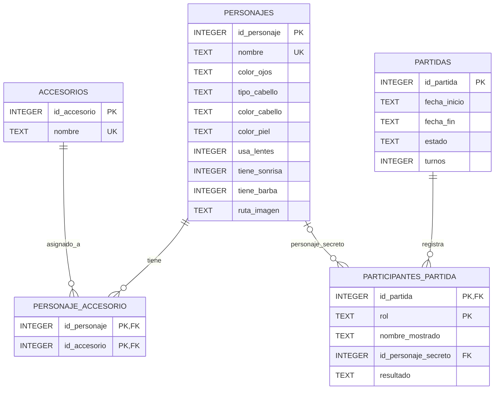

# Modelo entidad-relación

Modelo correspondiente al esquema SQLite de Adivina Quién. La vista `vista_estadisticas_jugador` es derivada y no almacena datos por separado.

## Cardinalidades y reglas

- Un personaje puede tener cero o varios accesorios; un accesorio puede pertenecer a varios personajes. `personaje_accesorio` resuelve esta relación N:M con PK compuesta.
- Una partida puede registrar participantes con roles distintos. `participantes_partida` limita cada rol a una fila por partida mediante la PK compuesta `(id_partida, rol)`; los roles permitidos son `HUMANO` y `COMPUTADORA`.
- Cada participante puede guardar cero o un personaje secreto. Un personaje puede ser secreto de varios participantes a lo largo del historial.
- Al borrar una partida se borran sus filas de participantes; al borrar un personaje se eliminan sus asociaciones a accesorios y se pone en `NULL` la referencia histórica al personaje secreto.
- Los campos booleanos se almacenan como `0/1`; `resultado` admite `VICTORIA`, `DERROTA` o `EMPATE`.
